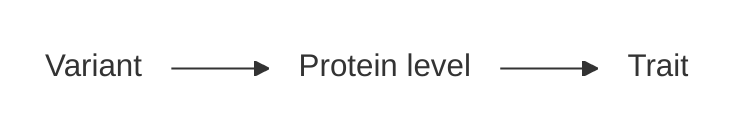
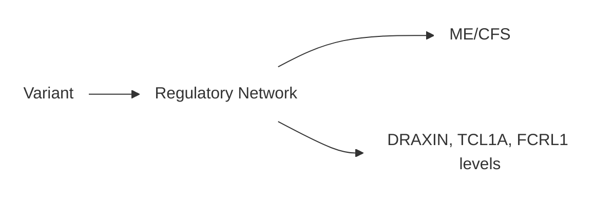

---
tags:
  - ABF colocalization
---
# PPP Colocalization

## Overview

I used [ABF Colocalization](../../../Bioinformatics_Concepts/Colocalization.md)[@giambartolomei2014bayesian] to search for loci at which [DecodeME](../../../Data_Sources/DecodeME.md) GWAS-1[@genetics2025initial] colocalized with Olink[@wik2021proximity] proteomic GWAS from the European discovery cohort of the [UK Biobank Pharma Proteomics Project](../../../Data_Sources/UKBB_PPP.md) (UKBB PPP)[@sun2023plasma].

## Results

This was an exploratory analysis, so I included all DecodeME loci at which the lead DecodeME variant had a p value less that $10^{-5}$.  Note that this is a looser threshold than is normally used for genome-wide significance.  The main results follow.  The table below includes all protein/ locus pairs at which the probability of colocalization exceeds 80%.

{{ coloc_results_table("docs/_figs/decode_me_gwas_1_exploratory_2_ppp_coloc_display.parquet", id="ukbb-ppp-coloc-decodeme" )}}

As the table shows, while DecodeME did not colocalize with proteomic GWAS at any of the DecodeME genome-wide-significant loci, there was colocalization at two sub-genome-wide-significant loci.

Below, I show Manhattan plots from DecodeME and the relevant proteomic GWAS at these loci:

{{
static_img_embed("docs/_figs/decode_me_gwas_1_exploratory_2_ppp_coloc_stack_plots_png/chr1_7941726-8941726.png")
}}

{{
static_img_embed("docs/_figs/decode_me_gwas_1_exploratory_2_ppp_coloc_stack_plots_png/chr12_123424955-124424955.png")
}}

I looked up the colocalizing proteins in proteomics databases:

{{
coloc_protein_info_table("docs/_figs/decode_me_gwas_1_exploratory_2_ppp_coloc_protein_info.parquet", id="decode-me-protein-info") 
}}

It is notable that both DRAXIN and CRIM1 pertain to nervous system development.

## Caveats

**Trans versus cis pQTL**: Note that DecodeME colocalizes with trans-pQTL (defined as pQTLs more than 1Mb from the gene coding for the protein) rather than cis-pQTL (defined as pQTLs within 1Mb of the gene coding for the protein).  Colocalization with cis-pQTL is generally much more mechanistically informative than colocalization with trans-pQTL.  This is because cis-pQTLs can be reasonably assumed to affect protein levels by directly regulating the synthesis of the protein in question, while a trans-pQTL may perturb a complex regulatory network in a way that changes protein levels only as a remote downstream consequence (see [Omnigenic model](../../../Bioinformatics_Concepts/Omnigenic_Model.md)).

Thus when a trait GWAS colocalizes with a cis-pQTL, we may infer a causal graph like this:

However, since DecodeME colocalizes with only trans-pQTL, the true causal graph may instead resemble:

**Bayesian Prior**:  Like any Bayesian method, ABF colocalization is sensitive to its prior.  The above analysis was based on the widely-used default ABF colocalization prior.  However, some authors have argued that this default prior is insufficiently conservative.

**Multiple testing**:  To handle multiple testing, I used a Bayesian false discovery rate approach.  However, this is not as conservative as standard frequentist multiple testing correction.

**Single causal variant assumption**: ABF colocalization depends on the assumption that each GWAS has at most one causal variant at each locus.  Eyeballing the Manhattan plots above suggests this assumption is reasonable for the loci in question, but it could be worthwhile to apply a method like SUSIE-coloc, which allows for multiple causal variants per locus.

**Participant overlap**:  The mathematical derivation of ABF colocalization relies on there being no overlap between the participants in the two GWAS being colocalized.  The PPP proteomics GWAS used UK Biobank participants, while DecodeME controls were also drawn from the UK Biobank.  Thus technically the above analysis violates the assumptions underlying ABF colocalization. Because the overlap is only partial, I do not expect that this had a major impact on our results.  Nevertheless, it is worth keeping in mind.  Attempting to replicate the above results using another proteomics GWAS that does not have participant overlap DecodeMe would be worthwhile.

## Next steps

- Investigating what is known about regulatory pathways involving the colocalizing proteins could be informative.
- Besides PPP, there are other large scale proteomics GWAS, such as Western et al.[@western2024proteogenomic] and the deCODE proteomics study[@ferkingstad2021large]. These proteomics GWAS use different technologies (SomaScan instead of Olink), different participants, and in the case of Western et al. a different bodily site (Western et al. uses cerebro-spinal fluid instead of plasma). Comparing colocalization results generated with these proteomic GWAS to the above PPP colocalization results could be revealing.

